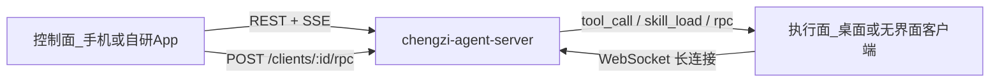

# 自定义客户端开发指南

面向要自研**桌面端 / 无界面客户端 / 手机应用**、并接入 `chengzi-agent-server` 的开发者。  
官方参考实现：

| 角色 | 仓库 | 说明 |
|------|------|------|
| 服务端 | `chengzi-agent-server` | 鉴权、对话、ClientHub、商店 |
| 有界面桌面 | `chengzi-agent-desktop` | Wails + Vue，完整本地能力（当前官方执行面） |
| 手机控制台 | `chengzi-agent-mobile` | Capacitor；不跑本地工具，遥控在线客户端 |

> 无界面客户端 `chengzi-agent-client` 已暂时移除；自研无界面节点请对照 `chengzi-agent-desktop` 的连接与 catalog 实现，或按本文 §3 伪代码编写。

本文约定：默认服务地址 `http://127.0.0.1:8182`，接口前缀 `/api`。

---

## 1. 先选角色：两类客户端

系统里有两种客户端，职责不同，不要混在一个进程里硬凑。



### 1.1 执行面（Online Client）

- 长连接挂到服务端，上报 `clientId`、工具 / 技能 / 智能体目录。
- 在本机执行 `tool_call`、返回技能正文、响应白名单 RPC。
- 官方：`chengzi-agent-desktop`（`chengzi-agent-client` 已暂时移除）。
- 适合：桌面壳、后台 daemon、工控机、CI 旁路节点。

### 1.2 控制面（Console）

- 只调 HTTP/SSE：登录、列在线客户端、开对话、遥控 RPC。
- **不**维护 `/api/clients/ws`，也**不**在手机上直接跑 `shell_exec` 等本地工具。
- 官方：`chengzi-agent-mobile`、管理后台 `web/`。
- 适合：安卓 / iOS / 纯 Web 控制台。

若只做「能聊、能选在线电脑」的手机 App → 走控制面。  
若要「本机文件 / 终端 / 安装 .cpk」→ 走执行面。

---

## 2. 统一约定

### 2.1 响应信封

业务 JSON 固定为：

```json
{ "code": 0, "msg": "", "data": null, "sysMsg": "" }
```

- `code === 0` 成功，否则失败；HTTP 状态码多数为 200，以 `code` 为准。

### 2.2 鉴权

优先：

```http
Authorization: Bearer <token>
```

也可用：

- 查询参数 `?token=`（**EventSource 必用**，浏览器无法给 SSE 加 Header）
- `X-API-Key` 或 `?api_key=`（API Key）

登录：

```http
POST /api/auth/login
Content-Type: application/json

{ "username": "admin", "password": "..." }
```

成功时 `data` 含 `token`、`user`（含 `id` / `username` / `name` / `role` / `roles`）。  
校验：`GET /api/auth/me`。

品牌（未登录可调）：`GET /api/brand` → `{ name, logo }`。

### 2.3 CORS（控制面跨域必开）

手机壳、独立域名前端与 API 不同源时，服务端需：

```yaml
# etc/chengzi.yaml
Cors:
  Enabled: true
  AllowedOrigins: ["*"]   # 生产建议收窄
```

WebSocket 升级本身放行 Origin；重点是 REST / SSE 跨域。

---

## 3. 开发执行面（桌面 / 无界面客户端）

最小闭环：**登录 → 选工作目录 → WebSocket 注册 → 上报 catalog → 处理下行消息**。

### 3.1 推荐流程

1. `POST /api/auth/login`，保存 `token`。
2. 生成本地稳定的 `clientId`（如主机名 / UUID），设置 `clientName`、`workspace`（绝对路径）。
3. 连接：

   ```
   ws://127.0.0.1:8182/api/clients/ws?token=<jwt>
   ```

   `https` 服务用 `wss`。查询参数里的 `clientId` / `name` 可选；**以首帧 register 为准**。

4. 连接成功后 **约 10 秒内**发送：

   ```json
   {
     "type": "register",
     "payload": {
       "clientId": "my-mac-01",
       "name": "研发机",
       "workspace": "/Users/me/work"
     }
   }
   ```

5. 按 **user-client-agent** 上报能力目录（HTTP，每个智能体单独一次 PUT）：

   ```http
   PUT /api/clients/catalog
   Authorization: Bearer <token>
   Content-Type: application/json

   {
     "clientId": "my-mac-01",
     "agentId": "weather-agent",
     "name": "天气助手",
     "description": "...",
     "systemPrompt": "...",
     "maxSteps": 0,
     "version": "1.0.0",
     "tools": [
       {
         "name": "read",
         "description": "读取工作目录内文件",
         "parameters": {
           "type": "object",
           "properties": {
             "path": { "type": "string", "description": "相对工作目录的路径" }
           },
           "required": ["path"]
         }
       }
     ],
     "skills": [
       { "id": "git-commit-zh", "name": "中文提交", "description": "..." }
     ],
     "osInfo": "darwin-arm64",
     "workspace": "/Users/me/work"
   }
   ```

   **注意**：
   - 客户端必须已在 WS 上线，否则 catalog 更新会被拒绝。
   - `osInfo` 格式为 `os-arch`（如 `windows-amd64`）；`workspace` 为当前工作目录绝对路径。
   - 同一 `clientId` 可为多个 `agentId` 分别 PUT；Redis 键为 `chengzi:catalog:{userId}:{clientId}:{agentId}`。
   - 目录有 TTL（默认约 90s，随心跳续期），能力变化时请重新 `PUT`。

6. 循环处理服务端下行帧，按 `id` 回传结果。

### 3.2 WebSocket 消息契约

帧形状：

```json
{ "type": "<string>", "id": "<可选关联 id>", "payload": { } }
```

| type | 方向 | 含义 |
|------|------|------|
| `register` | C→S | 上线身份 |
| `status` | C→S | 更新显示名 / 当前 workspace |
| `tool_call` | S→C | 执行工具：`name` + `arguments`（**JSON 字符串**） |
| `tool_result` | C→S | `{ "content": "...", "error": "..." }`，带相同 `id` |
| `skill_load` | S→C | `{ "skillId" }` |
| `skill_content` | C→S | `{ "skillId", "content", "error?" }` |
| `rpc` | S→C | `{ "method", "params" }` |
| `rpc_result` | C→S | `{ "result", "error?" }` |
| `ping` / `pong` | 双向 | 应用层心跳（另有协议层 Ping） |
| `error` | S→C | `{ "message" }` |

`tool_call` 示例回包：

```json
{
  "type": "tool_result",
  "id": "与下行相同的 id",
  "payload": { "content": "文件内容或结构化文本", "error": "" }
}
```

失败时把原因放进 `error`，`content` 可空；**不要断连**（未知 RPC 方法同理，返回 error 即可）。

### 3.3 必须实现的能力（按优先级）

| 优先级 | 能力 | 说明 |
|--------|------|------|
| P0 | `register` + 心跳保活 | 不上线则控制面看不到你 |
| P0 | `tool_call` / `tool_result` | 对话才能用本地工具 |
| P0 | `PUT /clients/catalog` | 工具与智能体对模型可见 |
| P1 | `skill_load` / `skill_content` | 技能正文按需拉取 |
| P1 | 白名单 RPC | 控制面遥控工作区 / 安装包等 |
| P2 | `.cpk` 安装与 env | 对齐商店与智能体分发（见 [cpk-format.md](./cpk-format.md)） |

### 3.4 服务端允许的 RPC（控制面经 HTTP 转发）

控制面调用：

```http
POST /api/clients/{clientId}/rpc
Authorization: Bearer <token>
Content-Type: application/json

{ "method": "workspace.list", "params": {} }
```

服务端只转发白名单方法（超时默认 60s）。控制台以对话为主，**不再**遥控安装智能体 / 技能 / 连接器 / 设置；白名单仅保留只读状态与会话绑定：

| method | 典型 params | 建议返回 |
|--------|-------------|----------|
| `link.status` / `workspace.list` | — | 公开状态（含 workspace 等） |
| `conversation.bind` / `unbind` / `agents` | 会话与智能体绑定 | — |

智能体 / 技能 / 工具以 `PUT /api/clients/catalog` 与 `GET /api/clients/catalog/agents` 为准，不再经 RPC 安装或改绑。

### 3.5 本地工具设计建议

- 所有路径相对 **当前 workspace** 解析，禁止任意逃逸到工作区外（官方用 `internal/files`）。
- `parameters` 使用 JSON Schema 子集（`type` / `properties` / `required`），供模型填参。
- 官方内置工具名可作兼容参考：`read`、`write`、`edit`、`find`、`grep`、`shell_exec`、`webfetch`、`write_stdin` 等；自研工具请用稳定、无空格的名字。
- 长耗时工具注意 `ClientAPI.InvokeTimeout`；可在结果里写阶段性说明。

### 3.6 配置落盘（可选兼容官方）

官方执行面默认使用：

```
~/.chengzi-agent/
  settings.json      # serverUrl, token, clientId, clientName, workspace, ...
  workspace/         # 默认工作目录
  packages/          # .cpk 安装树
  connectors.json
  workspaces/<hash>/ # 按工作目录隔离的技能与快照
```

自研客户端可自定目录，但若希望与桌面端共用登录态，请读写同一 `settings.json` 字段约定。

### 3.7 最小伪代码（执行面）

```text
token = login(server, user, pass)
ws = connect(wsURL(server) + "/api/clients/ws?token=" + token)
ws.send({ type: "register", payload: { clientId, name, workspace } })
for each installed agent:
  http.put("/api/clients/catalog", { clientId, agentId, name, systemPrompt, tools, skills, osInfo, workspace, ... })

loop message in ws:
  switch message.type:
    case "tool_call":
      out, err = runTool(message.payload.name, message.payload.arguments)
      reply("tool_result", message.id, { content: out, error: err })
    case "skill_load":
      reply("skill_content", message.id, loadSkill(message.payload.skillId))
    case "rpc":
      reply("rpc_result", message.id, dispatch(message.payload.method, params))
    case "ping":
      reply("pong", ...)
```

Go 参考：

- 连接：`chengzi-agent-desktop/internal/linkconn/client.go`
- 编排：`internal/appcore/app.go`（`Login` / `RegisterTools` / `ServeLink`）
- 协议：`pkg/clienthub/protocol`（服务端与客户端各有一份副本时可对照字段）

---

## 4. 开发控制面（手机 / Web App）

控制面**不连** `/api/clients/ws`。它依赖用户名下至少一台**已在线**的执行面。

### 4.1 推荐流程

1. 配置 `serverBaseUrl`（应用内可改），确认服务端 `Cors.Enabled`。
2. 登录，持久化 `token`（如 `localStorage`）。
3. 订阅在线列表：

   ```
   GET /api/clients/events?token=<jwt>
   ```

   SSE 事件：`online` / `offline` / `catalog`（另有注释心跳）。  
   也可轮询：`GET /api/clients` → `{ list: [{ clientId, name, workspace }] }`。

4. 用户选择 `clientId` 后，遥控或开聊。

### 4.2 遥控 RPC

```http
POST /api/clients/{clientId}/rpc
Authorization: Bearer <token>

{ "method": "agent.list", "params": {} }
```

手机端列智能体、切工作目录、装包等，都走这条通道（方法必须在服务端白名单内）。

### 4.3 对话（SSE）

```http
POST /api/conversations
Authorization: Bearer <token>
{ "modelId": 1, "clientId": "my-mac-01", "title": "可选" }

POST /api/conversations/{id}/chat
Authorization: Bearer <token>
Accept: text/event-stream
{ "content": "列出工作目录", "agentId": "weather-agent", "clientId": "my-mac-01" }
```

流式行为：`event: <type>` + `data: <Event JSON>`。常见 `type`：

`run_started`、`text_delta`、`reasoning_delta`、`tool_call_start`、`tool_call_end`、`ask_question`、`run_finished`、`error`、`context_usage` 等。

补充：

- 回答提问：`POST /api/conversations/{id}/questions/{questionId}`，body `{ "answers": [...] }`
- 回滚：`POST /api/conversations/{id}/revert`，`{ "messageId" }`
- 绑定工作区：`PUT /api/conversations/{id}/workspace`，`{ "workspace" }`（对话时优先使用 catalog 上报的 `workspace`）

服务端按 `(userId, clientId, agentId)` 从 Redis catalog 取 systemPrompt / tools / skills / osInfo / workspace，拼入系统提示词后再经 WS 调本地工具；聊天前务必保证执行面在线且已按智能体上报 catalog。

### 4.4 控制面清单

| 能力 | 接口 |
|------|------|
| 登录 / 我 | `/api/auth/login`、`/api/auth/me` |
| 品牌 | `/api/brand` |
| 在线客户端 | `/api/clients`、`/api/clients/events` |
| 遥控 | `/api/clients/:id/rpc` |
| 模型列表 | `/api/llm-models`（以实际路由为准） |
| 会话 CRUD / 聊天 | `/api/conversations*` |
| 商店浏览下载 | `/api/store/...`（安装仍多在执行面完成） |

参考：`chengzi-agent-mobile/src/api/`、`src/stores/session.ts`、`src/stores/chat.ts`。

---

## 5. 智能体包（.cpk）

执行面若要兼容官方商店 / 桌面安装体验，请实现 `.cpk`（zip）安装与 catalog 上报。格式见 [cpk-format.md](./cpk-format.md)。

要点：

- 含 `manifest.yaml`、`prompt.md`，可选 `skills/*/SKILL.md`、`icon.png`。
- 安装后技能 id 形如 `pkg:<packageId>:<skillDir>`，每个智能体单独 `PUT /api/clients/catalog`（含 `agentId`、`tools`、`skills`、`osInfo`、`workspace`）。
- 脚本环境变量：`CHENGZI_SERVER_BASE_URL`、`CHENGZI_PACKAGE_ID`、`CHENGZI_PACKAGE_DIR` 及用户填写的 `env`。

说明：部分旧文档仍写 `POST /api/agents`；**当前运行时以客户端 catalog 为准**，不要依赖服务端智能体 CRUD。

---

## 6. 联调检查表

### 执行面

- [ ] 登录拿到 token
- [ ] WS 能连上，10s 内 `register` 成功
- [ ] `GET /api/clients` 能看到自己的 `clientId`
- [ ] `PUT /api/clients/catalog` 成功；`GET /api/clients/catalog/agents` 能看到智能体
- [ ] 对话里模型能触发 `tool_call`，本机回 `tool_result`
- [ ] 故意回 RPC 错误时连接仍保持

### 控制面

- [ ] CORS 已开，登录与 `/api/brand` 正常
- [ ] `EventSource` 用 `?token=` 能收到 `online`
- [ ] 选定在线客户端后 `POST .../rpc` 成功
- [ ] `POST .../chat` 能收到 `text_delta` / `run_finished`
- [ ] 执行面断开时有明确「客户端离线」提示

### 服务端配置（本地）

```yaml
Port: 8182
Cors:
  Enabled: true
ClientAPI:
  InvokeTimeout: 60s
  HeartbeatInterval: 30s
Redis:
  # catalog / hub 依赖；按环境配置
```

---

## 7. 参考实现索引

| 主题 | 路径 |
|------|------|
| 协议常量与 payload | `chengzi-agent-server/pkg/clienthub/protocol` |
| Hub / 工具调用 / RPC 白名单 | `pkg/clienthub/` |
| WS / 聊天 SSE Handler | `internal/handler/custom/chat_ws.go`、`client_control.go` |
| 自定义路由注册 | `internal/handler/routes_custom.go` |
| 鉴权中间件 | `internal/middleware/auth_middleware.go` |
| CORS | `internal/handler/cors.go`、`etc/chengzi.yaml` |
| 桌面连接与 catalog | `chengzi-agent-desktop/internal/linkconn`、`appcore`、`chatapi` |
| 桌面 RPC 分发 | `chengzi-agent-desktop/internal/clientrpc` |
| 手机 HTTP / SSE | `chengzi-agent-mobile/src/api` |
| cpk 格式 | [cpk-format.md](./cpk-format.md) |

---

## 8. 常见坑

1. **先 WS 再 catalog**：未 register 就 `PUT /clients/catalog` 会失败。  
2. **EventSource 不能带 Authorization**：一律 `?token=`。  
3. **`tool_call.arguments` 是字符串**：先 `JSON.parse` 再执行。  
4. **智能体在客户端**：控制面 `agent.list` 走 RPC，不是服务端 REST 列表。  
5. **白名单**：自研 RPC 方法名若未加入服务端 `AllowedRPC`，控制面调不通（执行面本地可测，经 `/rpc` 不行）。  
6. **IDL 滞后**：`api/chengzi.api` 未覆盖全部自定义路由，以 `routes_custom.go` 与本文为准。  
7. **TTL**：catalog 会过期，断线重连后务必重新上报。

---

## 9. 从零选型建议

| 目标 | 建议 |
|------|------|
| 快速验证协议 | 先跑官方 `chengzi-agent-desktop` + `chengzi-agent-mobile` |
| 自研桌面（Electron/Tauri/Wails） | 复用/对照 `desktop` 的 `linkconn` + `clientrpc` + catalog，UI 自建 |
| 自研无界面节点 | 对照 `desktop` 连接实现，或按 §3 伪代码实现 |
| 自研手机 App | 只做控制面 §4；本地工具仍依赖用户电脑上的执行面 |
| 只要聊天不要本地工具 | 仍可开对话，但不绑 `clientId` / 不用本地 tools（能力受服务端配置的模型与远程工具限制） |

完成最小闭环后，再迭代安装包、连接器、多工作目录等高级能力即可。
